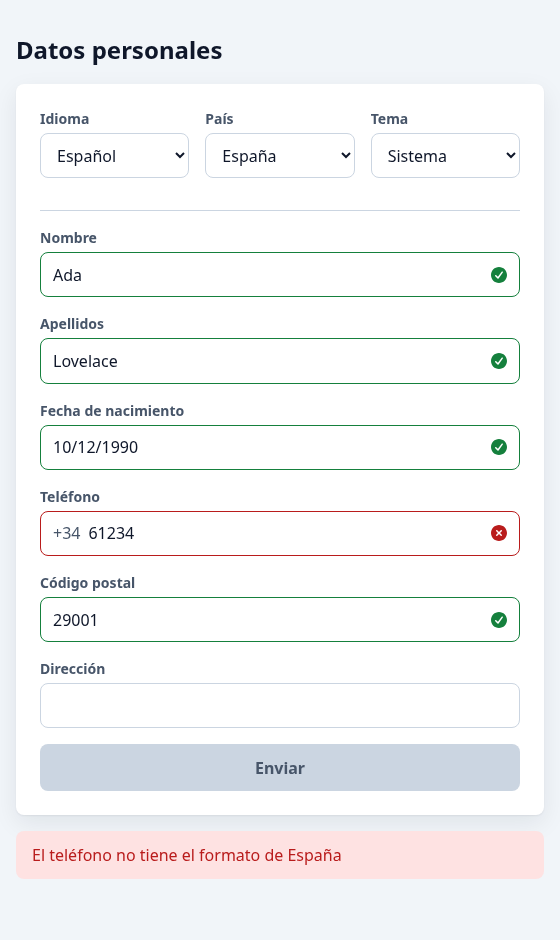
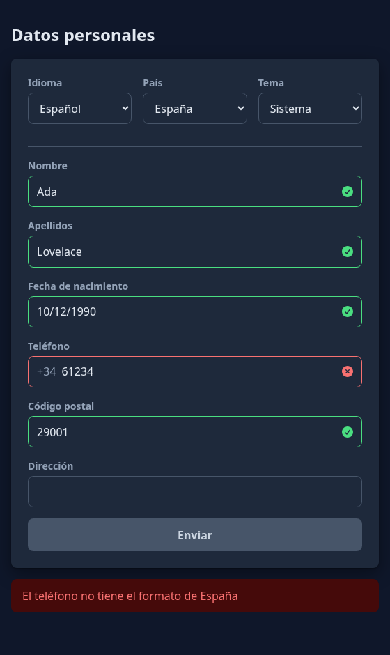
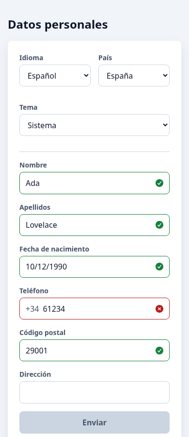
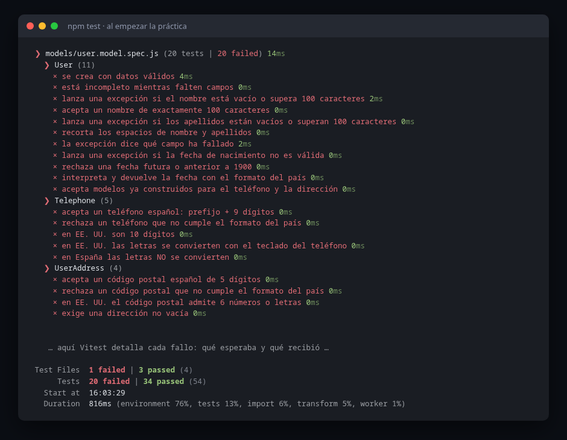
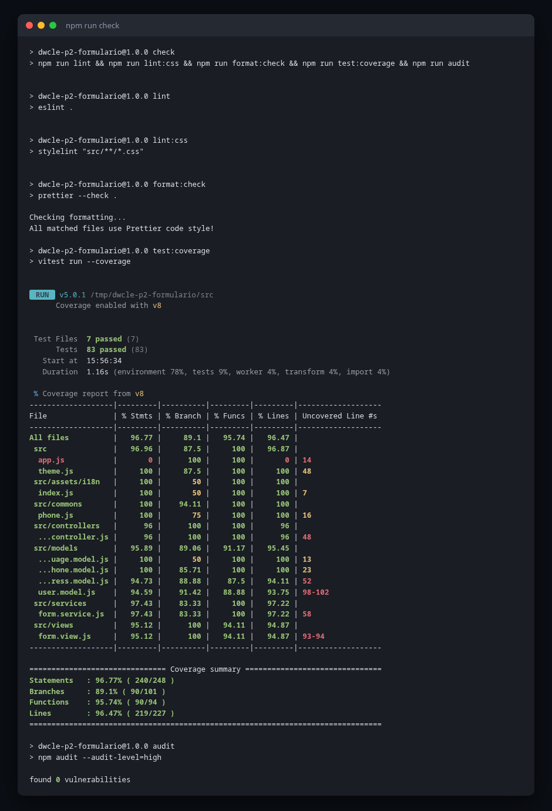
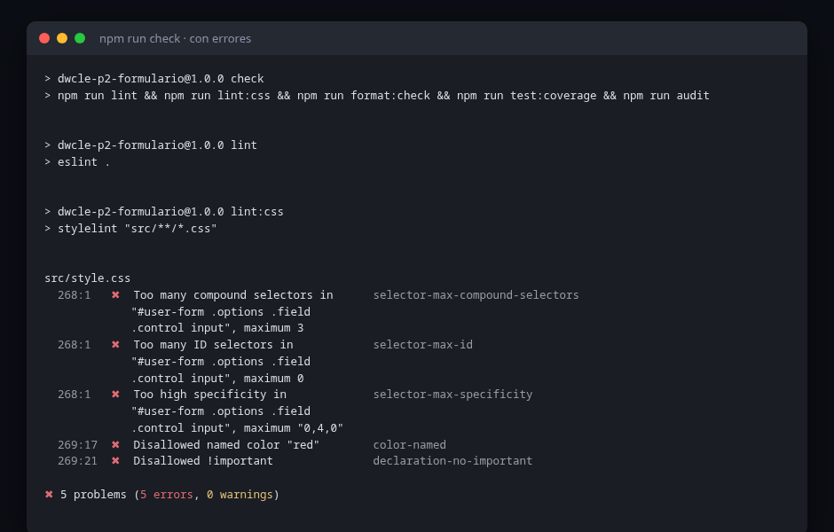
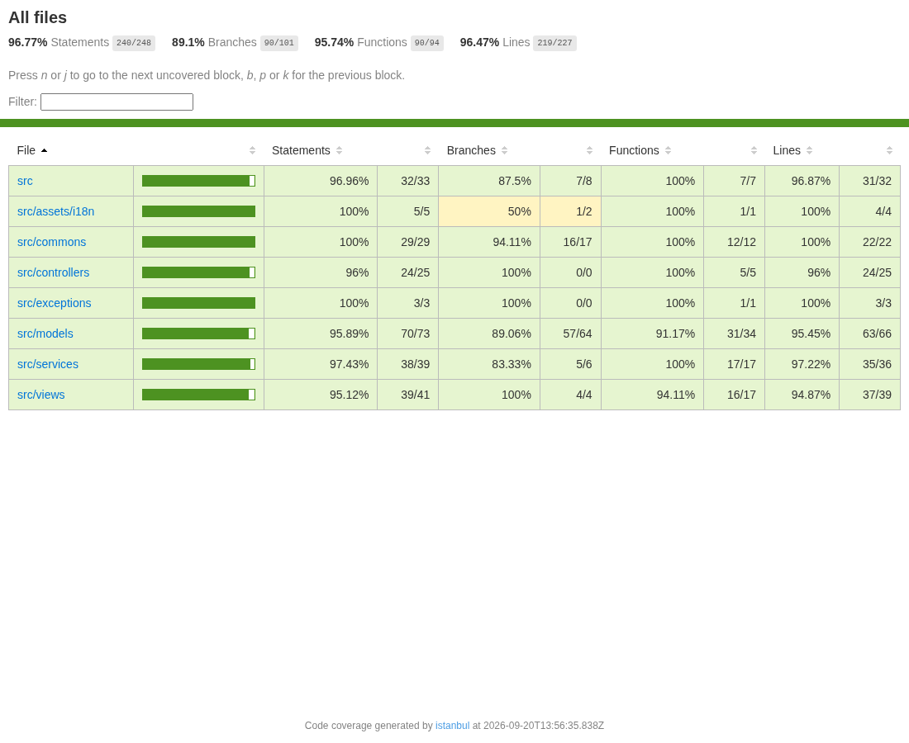
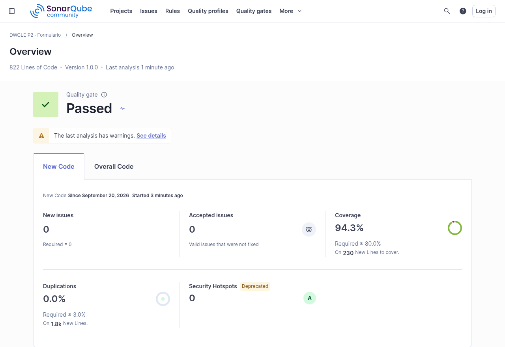

# DWCLE · P2 · Formulario

Hay que construir el siguiente formulario con el patrón **Modelo-Vista-Presentador (MVP)** en **JavaScript
sin frameworks**.

**El HTML y el CSS te los damos hechos** (`src/index.html` y `src/style.css`): aquí lo que se evalúa es la
lógica, no el diseño. El formulario es HTML estático y se actualiza dinámicamente con las validaciones de cada
campo (nombre, apellidos, etc.) y con la validación global al pulsar **Enviar**. El botón Enviar está
deshabilitado (`disabled`) hasta que todos los campos del formulario son válidos.

## Arranque

Necesitas **Node 24** (`node -v`).

```bash
npm install
npm run dev          # abre el formulario en el navegador y recarga al guardar
npm test             # tests del modelo y del servicio
npm run test:watch   # los tests se repiten al guardar
```

Estructura de partida (MVP, un fichero por clase con el nombre `nombre.tipo.js`):

```
src/
├── index.html        el formulario ya escrito: no hace falta que lo toques
├── app.js            raíz de composición: crea servicio, vista y controlador y los conecta
├── style.css         los estilos, ya escritos
├── models/           User, Telephone, UserAddress… (user.model.js)
├── services/         FormService (form.service.js)
├── views/            FormView: lo único que toca el DOM (form.view.js)
├── controllers/      FormController: une vista y servicio (form.controller.js)
├── exceptions/       excepciones propias del modelo
└── assets/i18n/      textos en español e inglés
docs/uml/class-diagram.puml   diagrama de partida
```

## Así se ve

El HTML y el CSS se entregan hechos: tú solo cambias clases desde la vista. El borde del campo se tiñe solo
con que su icono tenga la clase `valid` o `invalid`.

| Claro                                                  | Oscuro                                                   |
| ------------------------------------------------------ | -------------------------------------------------------- |
|  |  |

El desplegable **Tema** permite elegir entre seguir al sistema operativo, claro u oscuro. Lo gestiona
`src/theme.js`, que también se entrega hecho y no forma parte de la práctica.



## Campos del formulario

| Campo                                 | Tipo                                            | Formato en España           | Formato en EE. UU.                                    |
| ------------------------------------- | ----------------------------------------------- | --------------------------- | ----------------------------------------------------- |
| **Nombre** · _Name_                   | Texto, máximo 100 caracteres                    | —                           | —                                                     |
| **Apellidos** · _Surname_             | Texto, máximo 100 caracteres                    | —                           | —                                                     |
| **Fecha de nacimiento** · _Birthdate_ | Fecha (clase que usa la biblioteca `date-fns`)  | `dd/MM/yyyy`                | `MM/dd/yyyy`                                          |
| **Teléfono** · _Phone number_         | Teléfono (clase con prefijo y número)           | Prefijo + 9 números         | Prefijo + 10 números, o letras del teclado telefónico |
| **Dirección** · _Address_             | Dirección (clase con código postal y dirección) | CP de 5 números + dirección | CP de 6 números o letras + dirección                  |

> **Sobre el teléfono de EE. UU.**: los números norteamericanos tienen **10** cifras, no 9. Además admiten
> letras, porque el teclado del teléfono las asocia a dígitos (`2` = ABC, `3` = DEF… `9` = WXYZ): el famoso
> `1-800-FLOWERS` es en realidad `1-800-356-9377`. Tu modelo debe convertir esas letras a números **antes** de
> validar, y hacerlo **solo en EE. UU.**: en España no se usan, y si convirtieras siempre, `61234567A` pasaría
> por el número válido `612345672`.

Las etiquetas de todos los campos cambian según el desplegable de **idioma**.

## Opciones del formulario

- **Idioma**: desplegable Español / Inglés. Cambia el idioma de la vista: los textos asociados a cada campo
  (etiquetas o `span`) y los `placeholder` si los hay.
- **País**: desplegable España / EE. UU. Cambia el formato que se exige en los campos.

## Modelo y envío

Al pulsar **Enviar** se crea el modelo del usuario (`User`) y se muestra un mensaje si todo ha ido bien.

El modelo se protege a sí mismo: sus **setters lanzan excepciones** cuando no se cumple una condición. Esto no
sustituye a la validación de la vista: se hacen las dos. La vista avisa al usuario mientras escribe; el modelo
garantiza que nunca existe un `User` inválido, venga de donde venga.

## Requisitos de la vista

- Junto a cada campo aparece un icono de **Font Awesome** que indica si el valor es válido: el check verde
  (`fa-circle-check`) si lo es y la cruz roja (`fa-circle-xmark`) si no. Se actualiza con eventos, mientras el
  usuario escribe o al salir del campo.
- Si algún campo no es válido, el botón Enviar está deshabilitado (`disabled`).
- Para el idioma, guarda los textos de los dos idiomas en un JSON o un objeto (`assets/i18n/`). Al cambiar el
  desplegable de idioma, un evento actualiza las etiquetas de los campos.

Font Awesome ya está instalado: `app.js` importa su CSS y basta con escribir
`<i class="fa-solid fa-circle-check"></i>`.

### Los enganches que te da el HTML

Tu vista trabaja contra este HTML, así que **no cambies estas tres cosas** (si lo haces, tendrás que adaptar tu
código y decirlo en el README de tu entrega):

| Enganche                                                                          | Para qué sirve                                             |
| --------------------------------------------------------------------------------- | ---------------------------------------------------------- |
| `id` de cada campo: `name`, `surname`, `birthDate`, `telephone`, `zip`, `address` | Seleccionar los `input` desde la vista                     |
| Un `<i>` vacío justo detrás de cada `input`                                       | Donde se pone la clase del icono (`nextElementSibling`)    |
| `data-i18n="clave"` en las etiquetas                                              | Recorrerlas para cambiar el idioma sin buscarlas una a una |

Además hay `#user-form`, `#submit`, `#message`, `#prefix`, `#language` y `#country`. El CSS colorea el borde
del campo solo con que su icono tenga la clase `valid` o `invalid`: tú no tocas estilos, solo clases.

El diseño es libre a partir de ahí: si quieres cambiar el aspecto, adelante, pero no puntúa.

## Diagrama de clases

El diagrama de partida está en [`docs/uml/class-diagram.puml`](docs/uml/class-diagram.puml). Es una guía: si
tu diseño cambia, actualízalo. Para verlo, instala la extensión PlantUML en VS Code (`Alt+D` abre la vista
previa).

## Tests

**Los tests del modelo vienen escritos y empiezan en rojo.** `src/models/user.model.spec.js` son 20 tests que
definen exactamente lo que tiene que hacer `User`, `Telephone` y `UserAddress`. Tu trabajo es ponerlos en verde:

```bash
npm run test:watch     # se relanzan solos cada vez que guardas
```

Léelos antes de escribir nada: la cabecera del fichero explica cómo está montado un test (preparar, actuar,
comprobar), qué comparador usar en cada caso (`toBe`, `toEqual`, `toThrow`) y **por qué se ha elegido cada
caso** en vez de otros. En resumen: no se prueba "que funcione", se prueban las fronteras, que es donde están
casi todos los errores.

Se te dan hechos para que veas cómo se escribe una batería de tests decente. **En las siguientes prácticas los
escribirás tú.**

Lo que sigue siendo tuyo:

- **los tests del servicio** (`FormService`): obligatorios, y no vienen dados;
- los del modelo que quieras añadir a los 20 de partida;
- los de la vista, que son opcionales.

En `src/models/` tienes el esqueleto de las tres clases con sus campos privados y los setters marcados con
`// tu código aquí`. Los métodos sin implementar lanzan un `Error` normal a propósito, para que ningún test
pase por accidente mientras no hay código de verdad.

## Material de apoyo

- [`02-JavaScript/12-mvp-first`](https://github.com/politecnicoDAW-2026/DWCLE-clase/tree/main/02-JavaScript/12-mvp-first): las tres capas en
  el ejemplo más pequeño posible.
- [`02-JavaScript/13-mvp-todo`](https://github.com/politecnicoDAW-2026/DWCLE-clase/tree/main/02-JavaScript/13-mvp-todo): modelo que valida con
  setters, vista con `bind*`, idioma con diccionarios. Su `docs/uml/form.puml` es el boceto de esta práctica.
- `02-JavaScript/14-exceptions` (se publica en clase): excepciones propias con datos del campo que falla.
- `03-events` y `04-forms` de la unidad 4, DOM y BOM (se publican en clase): eventos `input`, `change` y
  `blur`, validación nativa del navegador y errores junto al campo.
- [Documentación de date-fns](https://date-fns.org/docs/Getting-Started): `parse`, `format`, `isValid`.

## Calidad: cómo se pasa

La calidad no es un extra al final: es parte de la entrega y se comprueba con **un solo comando**.

```bash
npm run check
```

Ejecuta, en este orden y parándose en el primero que falle:

| #   | Paso                      | Qué comprueba                                                                       |
| --- | ------------------------- | ----------------------------------------------------------------------------------- |
| 1   | `lint` (ESLint)           | Errores de JavaScript: variables sin usar, cosas no declaradas, comparaciones raras |
| 2   | `lint:css` (Stylelint)    | El CSS: sin `id` ni `!important`, especificidad máxima `0,4,0`, orden de selectores |
| 3   | `format:check` (Prettier) | Que el formato es el del proyecto (comillas, ancho, comas)                          |
| 4   | `test:coverage` (Vitest)  | Que los tests pasan **y** que cubren al menos el 70 % de `models/` y `services/`    |
| 5   | `audit` (npm)             | Que ninguna dependencia tiene vulnerabilidades graves                               |

Es exactamente lo mismo que ejecuta GitHub Actions al hacer push
(`.github/workflows/ci.yml`). Si pasa en tu máquina, pasa en la CI.

### El primer día, esto falla. Y está bien

Recién descargado el proyecto, `npm run check` **termina en rojo**: los 20 tests del modelo esperan un código
que todavía no has escrito. No está roto, es el punto de partida.



Lo que sí está en verde desde el minuto uno son los tests que no dependen de ti: accesibilidad, contraste y
selector de tema. Si alguno de esos se pone en rojo, es que has roto algo que funcionaba.

### Esto es lo que tienes que ver al terminar



Fíjate en las tres cosas que se miran al corregir: **tests en verde**, **cobertura por encima del 70 %** en
`models/` y `services/`, y **0 vulnerabilidades**.

### Y esto es lo que verás cuando algo falle



No te asustes con la lista: cada línea dice el fichero, la línea, el problema y **el nombre de la regla**. Ese
nombre es lo que hay que buscar si no entiendes el mensaje. En el ejemplo se ve por qué no vale apilar
selectores: `#user-form .options .field .control input` rompe tres reglas a la vez.

### El camino corto

```bash
npm run lint:fix        # arregla solo lo que ESLint sabe arreglar
npm run lint:css:fix    # lo mismo con el CSS
npm run format          # reformatea todo con Prettier
npm run check           # y vuelves a comprobar
```

Casi todo lo de formato se arregla con esos tres comandos. Lo que quede es trabajo de verdad.

### Cobertura

`npm run test:coverage` deja un informe navegable en `coverage/index.html`: ábrelo en el navegador y verás,
fichero a fichero, qué líneas no prueba ningún test.



El mínimo es el **70 %** de líneas, funciones y ramas en `models/` y `services/`. Por debajo, el comando falla.
Ojo: cubrir no es lo mismo que probar bien. Un test que ejecuta una función sin comprobar nada sube la
cobertura y no vale para nada.

### Accesibilidad y contraste: ya vienen resueltos, no los rompas

El proyecto trae dos comprobaciones que se ejecutan con los demás tests:

- **`src/a11y.spec.js`** pasa [axe](https://github.com/dequelabs/axe-core) sobre el formulario: cada campo con
  su etiqueta, los iconos fuera del árbol de accesibilidad, el mensaje anunciado a los lectores de pantalla.
- **`src/style.contrast.spec.js`** calcula el contraste de color de las dos paletas (clara y oscura) según
  WCAG y exige el nivel AA (4.5).

Como el HTML y el CSS se entregan hechos, los dos pasan desde el primer día. Si tocas el marcado o los colores
y se ponen en rojo, es que has empeorado la accesibilidad: el test te está avisando de algo real.

### Antes de cada commit

Husky ejecuta ESLint, Stylelint y Prettier **solo sobre lo que cambias**, y comprueba que el mensaje sigue
_Conventional Commits_ (`feat: …`, `fix: …`). Si el commit se rechaza, lee el error: es el mismo que verías en
la CI, pero antes.

### El resto de scripts

| Script                  | Qué hace                                                                       |
| ----------------------- | ------------------------------------------------------------------------------ |
| `npm test`              | Ejecuta los tests una vez                                                      |
| `npm run test:watch`    | Tests en modo vigilancia mientras programas: lo que más vas a usar             |
| `npm run test:coverage` | Tests con cobertura en `coverage/` (`index.html` y `lcov.info` para SonarQube) |
| `npm run build`         | Compila a `dist/`: tiene que terminar sin errores                              |
| `npm run uml`           | Regenera los PNG de `docs/uml/*.puml` con PlantUML en Docker                   |
| `npm run sonar:up`      | Arranca SonarQube en local con Docker (http://localhost:3300)                  |
| `npm run sonar:scan`    | Tests con cobertura y análisis en SonarQube (token en `.env`)                  |
| `npm run sonar:down`    | Para SonarQube conservando sus datos                                           |

- **VS Code:** al abrir la carpeta te propondrá las extensiones recomendadas. Con ellas se formatea al
  guardar y ESLint marca los errores mientras escribes (`.vscode/settings.json`).
- **UML:** el diagrama vive en `docs/uml/`. Al subir un `.puml`, `.github/workflows/main.yml` genera su PNG.
  En local, `npm run uml` (necesita Docker) o la extensión PlantUML de VS Code.

### SonarQube, en local

`npm run sonar:up` y `npm run sonar:scan` antes de entregar. Es el mismo SonarQube para todas las prácticas: el
token se crea una vez (`apps/sonarqube/readme.md`) y se copia en el `.env` de cada una. Al terminar el análisis,
abre <http://localhost:3300>.



Lo que se mira en la entrega:

| Métrica                | Qué se espera                                                                              |
| ---------------------- | ------------------------------------------------------------------------------------------ |
| **Quality Gate**       | `Passed`. Es lo primero que se mira                                                        |
| Bugs, vulnerabilidades | 0                                                                                          |
| Code smells            | Revisados. Si dejas alguno a propósito, explica por qué en `ENTREGA.md`                    |
| Coverage               | El Quality Gate pide **≥ 80 % sobre el código nuevo** (más que el 70 % de `test:coverage`) |
| Duplications           | ≤ 3 %                                                                                      |

SonarQube ve cosas que ni ESLint ni Stylelint detectan, porque entiende el HTML y el sentido del código. En esta
misma práctica encontró, por ejemplo, que `autocomplete="street-address"` no es el valor correcto para un
`input` de una línea (es `address-line1`), y que para el mensaje del formulario lo suyo es `<output>` y no un
`<p role="status">`. Los dos arreglos ya están en el HTML que se te entrega.

> Si al entrar te pide cambiar la contraseña de `admin`, ojo: SonarQube exige **12 caracteres como mínimo**.

## Entrega

- Rellena [`ENTREGA.md`](ENTREGA.md): cómo arrancar, qué funciona, decisiones de diseño y calidad.

- **Se publica:** miércoles 14 de octubre de 2026.
- **Se entrega:** miércoles 21 de octubre de 2026, antes de las 23:59.
- Repositorio individual con `npm test` en verde y `npm run build` sin errores.
- `README.md` propio: cómo arrancarlo y las decisiones de diseño que hayas tomado.
- El diagrama de `docs/uml/` actualizado con tu diseño final.
- Commits pequeños con mensajes convencionales (`feat: valida el teléfono según el país`).

Se evalúa con la rúbrica común del módulo (se publica en DWCLE-clase).
